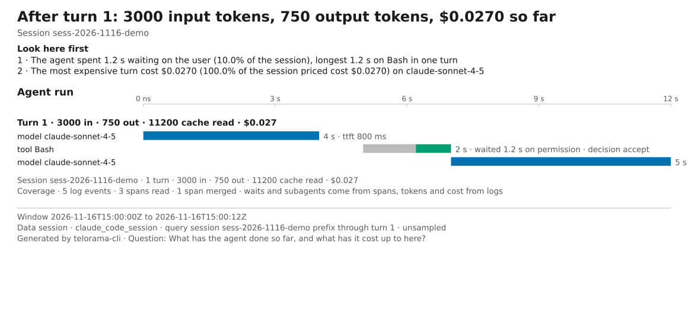
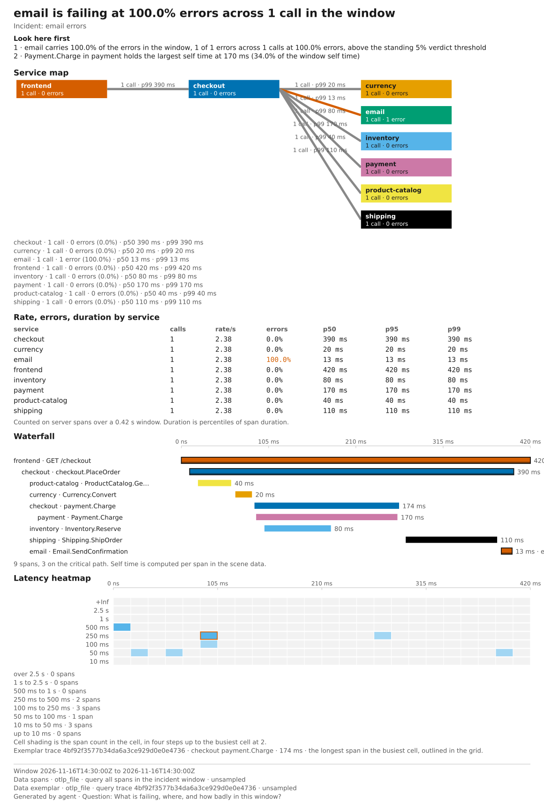

# telorama

telorama is a visualization engine for OpenTelemetry data. An AI agent describes the diagram it wants in a small structured document called a scene spec. telorama checks the spec against a set of honesty rules, works out the geometry itself, and renders a finished diagram that can appear inside an AI chat, a pull request, or a plain file.



The [gallery](docs/gallery.html) shows every scene family rendered from the test fixtures, each carrying the findings the investigation layer reports for its data.

The verdict viewer in the web directory renders one recorded investigation end to end. Its [scene reel](docs/media/viewer-reel.mp4) shows that record's incident scene and session frames exactly as the tools rendered them.

## What it does

- It turns a trace into a waterfall diagram that shows where one request spent its time and which part of the work sits on the critical path.
- It summarizes a service with rate, error, and duration figures drawn from the same trace data, with duration reported as percentiles and never as an average.
- It draws service maps whose edges come only from calls the traces actually contain, with a ranked rate, error, and duration summary beneath the map.
- It draws sankey diagrams of span flow staged by call depth and counted span by span, with any span whose parent is missing from the data or whose ancestry cycles entering through a named residual bucket in the open instead of being silently staged as a root.
- It draws latency heatmaps from declared histogram buckets and names one real span from the data as the exemplar of the busiest cell, never an invented link.
- It draws flame graphs from sampled profiles, and it checks that a profile carries exactly the sample count the spec declares before it renders.
- It turns an agent session into a run diagram that shows each turn, each model call and tool call, the time spent waiting on permissions, and what the session cost in tokens and money.
- It reads Codex session exports as well as Claude Code ones. Codex reports no cost of its own, so telorama prices the tokens itself and prints on the diagram that the figure is its own estimate.
- It reads agent sessions recorded as spans alone, in the GenAI semantic conventions and in OpenInference, and maps them into the same run diagram. A model its price table does not know is named on the diagram as unpriced, with its tokens counted and its cost left out rather than folded in as zero.
- It composes the first scene of an incident itself from a window of traces. It states its rules and follows them. It picks the failing service and one exemplar trace and assembles a service map, a rate error duration summary, the exemplar waterfall, and a latency heatmap, with a headline derived from the same numbers the panels print.
- It ranks what an investigator should look at first. From the same derivations the panels print, it states a short list of findings in a fixed order, errors before latency before waiting before cost, each with the evidence numbers and a real exemplar from the data, and each stating evidence only and never a remedy.
- It draws an agent state panel from a working agent's own report of what it is doing and why. A report entry with an empty action or an empty reason is refused, and a state panel with no report behind it fails rather than drawing empty.
- It turns a session into a stream of frames, one complete scene per turn boundary. Each frame shows the session only up to that turn, its tokens, its cost, and its coverage counted from that prefix alone, so an investigator can step through the run as it unfolded. The interactive view steps through the frames by replacing the whole picture, and nothing in the data ever animates.
- It renders every diagram deterministically. The same spec and the same data always produce the same file, byte for byte, so a rendered diagram can be checked in tests and compared across changes.
- It renders every scene in a light theme or a dark one, the choice carried in the spec itself. The dark palette is checked pair by pair against contrast floors computed from its own constants, and the two themes are proven to differ only in color.
- It prints the source, the query, the time window, and the sampling state on every scene, so a reader can tell where each number came from.
- It serves scenes over MCP as short text a model can read, structured figures, and an interactive view for chat surfaces that can render one, and it can write any scene as a single standalone HTML file with nothing left to fetch.



## How it is used

The command line tool reads a scene spec plus the data its panels name and writes an SVG image. The data can be an OpenTelemetry trace export in OTLP JSON form, a folded stack profile, or an agent session export of OTLP logs and spans. The tool and the MCP server install from crates.io with `cargo install telorama` and `cargo install telorama-mcp`.

```text
telorama render --scene scene.json --traces traces.json --out scene.svg
telorama render --scene flame.json --profile stacks.txt --out flame.svg
telorama render --scene run.json --session-logs logs.json --session-spans spans.json --out run.svg
telorama render-html --scene scene.json --traces traces.json --out scene.html
telorama validate scene.json
telorama inspect traces.json
telorama session --logs logs.json --spans spans.json
telorama session --logs codex-logs.json --dialect codex
telorama session --spans genai-spans.json --dialect genai
telorama incident --traces traces.json --out incident.json --render incident.svg
telorama frames --logs logs.json --spans spans.json --out frames.jsonl --html framebook.html
```

The validate command checks a scene spec against the schema and the honesty rules without rendering it. The inspect command summarizes a trace file by service, span count, and time range, so an agent can learn what data exists before it writes a spec. The session command prints an agent run as JSON for tools that read text rather than pictures. Four session dialects are supported, Claude Code, Codex, GenAI, and OpenInference. The incident command composes an incident scene from a trace export and prints the spec, rendering it as well when asked. The frames command writes one JSON payload per turn boundary for a session, and can also write a static framebook page that stacks the frames with no scripts. Renders from the command line and the MCP server carry the ranked findings automatically. Worked examples for all these flows live in the examples directory.

The same engine also runs as an MCP server, the telorama-mcp program, speaking JSON-RPC over standard input and output. A host connects it once and its tools validate a spec, summarize a trace export, adapt a session, build a session frame stream, compose an incident scene, and render a scene. A render returns short text the model can read, structured figures drawn from the same workings as the picture, and the picture itself for hosts that can show the interactive view. The frame stream tool hands the view every frame, and the view steps through them by replacement. One further tool exists only for that view and fetches the detail behind a single panel, so drilling down costs the model no context. The scene spec stays the same across every surface. The plugin directory packages the server for Claude Code together with a skill that teaches an agent when to render what.

## Current state

Milestones 1 through 5 are complete, and thirteen rounds of the perfection roadmap have followed them. The scene spec, the honesty validator, the field system of units and thresholds, the OTLP trace and profile readers, the session adapters for Claude Code, Codex, GenAI, and OpenInference, the deterministic SVG renderer, the standalone HTML export, the MCP server with its interactive view, incident composition, the Claude Code plugin and agent skill packaging, and worked examples are in place. The live observability milestone is landed on top of that static core. Renders carry a ranked investigation layer whose findings derive from the same numbers the panels print, scenes can carry an agent state panel whose entries must say what the agent is doing and why, and a session renders as a stream of prefix frames that the view steps through by replacement. The renderer covers waterfall, stat, and RED panels, service maps, sankey diagrams, latency heatmaps, flame graphs, agent run diagrams, and agent state panels, with a golden test corpus of thirteen scenes built from realistic fixtures in the shape of the OpenTelemetry Demo and recorded agent sessions in all four dialects, five of the scenes pinned in both themes. The dialect adapters and the price table are kept current against the conventions as they move, and the engine is proven at ten thousand spans and a hundred thousand samples against wall-clock ceilings set from its own measured runs. Every public item in the library crates carries a doc comment under a deny gate. Every derivation terminates on cyclic input, no derivation, verdict, walk, or drop in the workspace recurses over the depth of its input, and agent runs nest under a stated budget of 512 subagent levels that the session builders enforce by refusing a deeper session whole. The command line and the MCP server rank the same findings over the same inputs for the same session. Every crate carries full package metadata, and all five crates are published on crates.io at version 0.3.0.

## Licence

telorama is available under the MIT licence or the Apache License, Version 2.0, at your choice.
