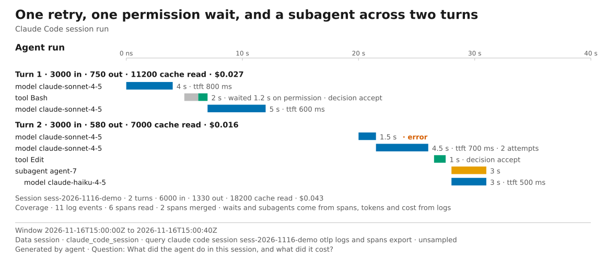

# telorama-ingest

The readers of the telorama visualization engine. This crate parses OpenTelemetry trace exports in OTLP JSON form, folded stack profiles, and agent session exports, and adapts them into the canonical models the scene crate derives from.

Four session dialects are supported. Claude Code and Codex sessions adapt from their log and span exports, and sessions recorded as spans alone map through the GenAI semantic conventions and OpenInference. Codex exports no cost of its own, so calls in that dialect are priced from the engine's own table and marked as its estimate. The GenAI adapter reads the union of the convention generations, pinned to a named commit of the conventions repository, so a span from any generation maps the same way.

The project lives at https://github.com/david-engelmann/telorama, where the gallery shows every scene family rendered from the test fixtures.

telorama-ingest is available under the MIT licence or the Apache License, Version 2.0, at your choice.
