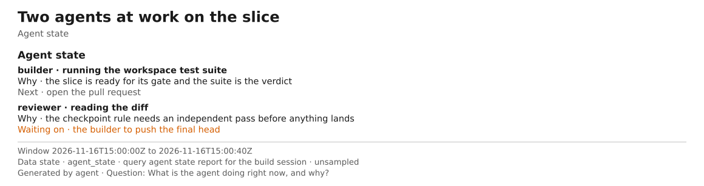

# telorama-mcp

The MCP server of the telorama visualization engine, speaking JSON-RPC over standard input and output. A host connects it once and its tools validate a scene spec, summarize a trace export, adapt a session, build a session frame stream, compose an incident scene, and render a scene.

A render returns short text a model can read, structured figures drawn from the same workings as the picture, and the picture itself for hosts that can show the interactive view, an MCP App built on the stable SEP-1865 contract. The frame stream tool hands the view every frame, and the view steps through them by replacement. One further tool exists only for that view and fetches the detail behind a single panel, so drilling down costs the model no context.

Install it with cargo install telorama-mcp. The project packages the server for Claude Code together with a skill that teaches an agent when to render what.

The project lives at https://github.com/david-engelmann/telorama, where the gallery shows every scene family rendered from the test fixtures.

telorama-mcp is available under the MIT licence or the Apache License, Version 2.0, at your choice.
