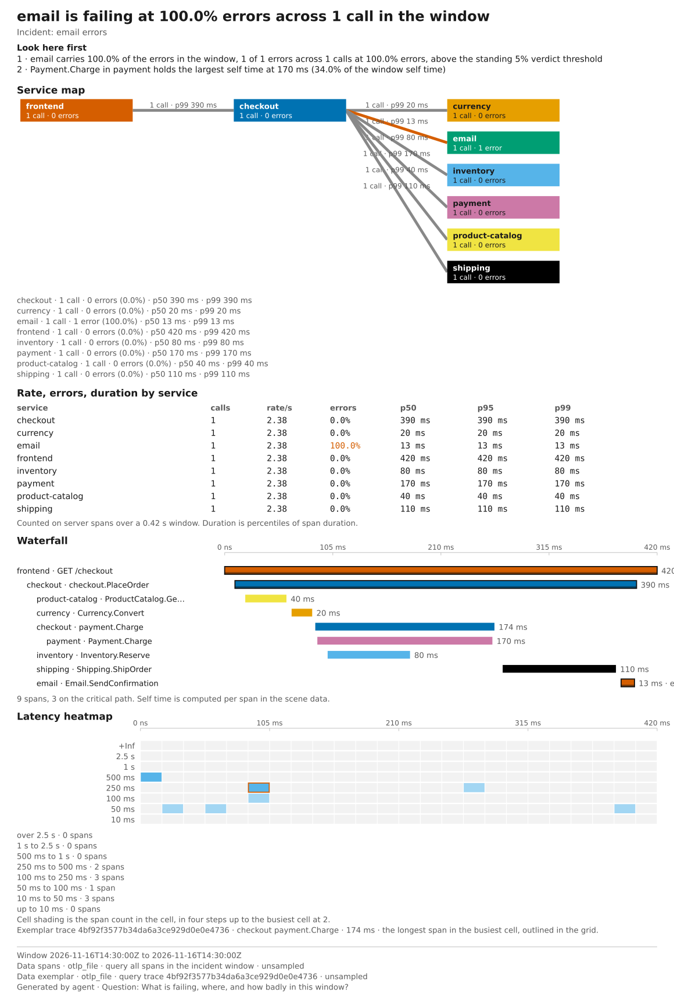

# telorama-svg

The deterministic renderer of the telorama visualization engine. It takes a validated scene plus its data and produces an SVG diagram, or a standalone HTML page carrying one, byte for byte the same on every run.

Panels cover trace waterfalls, stat and RED summaries, service maps, sankey flow diagrams, latency heatmaps, flame graphs, agent run diagrams, and agent state panels. A scene may carry a dark theme, whose palette is checked pair by pair against contrast floors computed from its own constants, and the two themes are proven to differ only in color. Renders made through the tools carry the ranked findings strip the scene crate derives.

The project lives at https://github.com/david-engelmann/telorama, where the gallery shows every scene family rendered from the test fixtures.

telorama-svg is available under the MIT licence or the Apache License, Version 2.0, at your choice.
