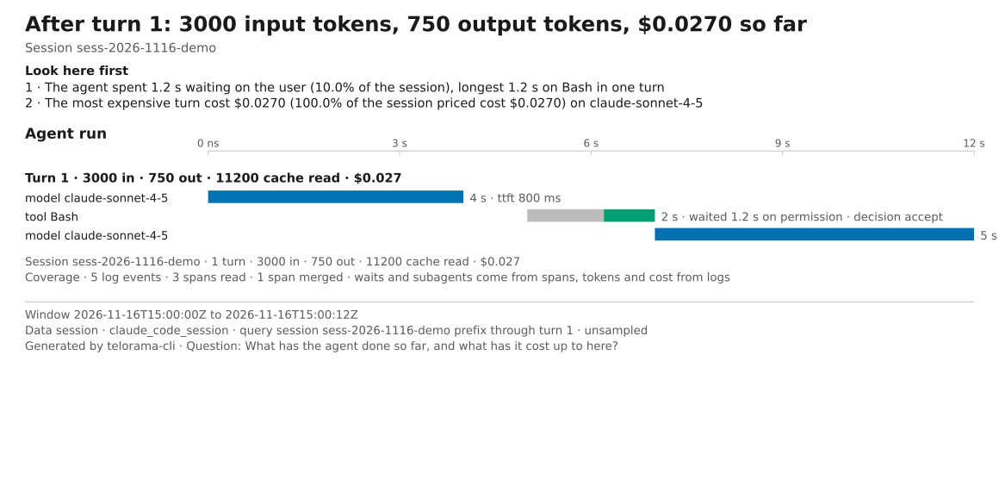

# telorama

The command line tool of the telorama visualization engine. It reads a scene spec plus the data its panels name and writes an SVG image. It checks a spec against the schema and the honesty rules without rendering it, summarizes a trace export, prints an agent session as JSON, composes an incident scene from a window of traces, and writes a session as a stream of frame payloads, one complete scene per turn boundary.

Install it with cargo install telorama. The same engine runs as an MCP server from the telorama-mcp crate, and the project packages that server for Claude Code together with an agent skill.

The project lives at https://github.com/david-engelmann/telorama, where the gallery shows every scene family rendered from the test fixtures.

telorama is available under the MIT licence or the Apache License, Version 2.0, at your choice.
